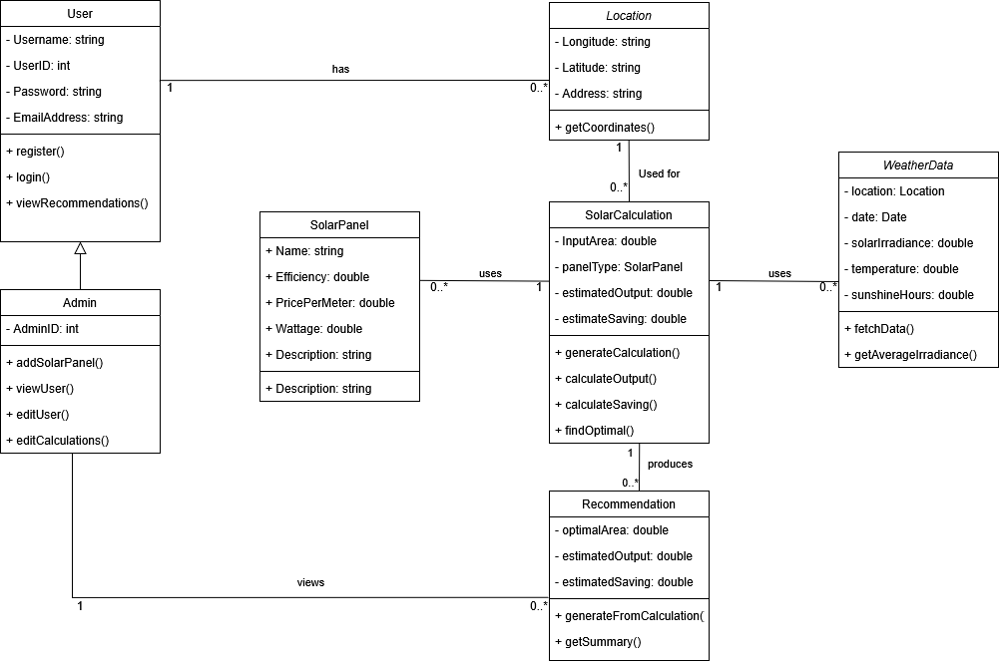
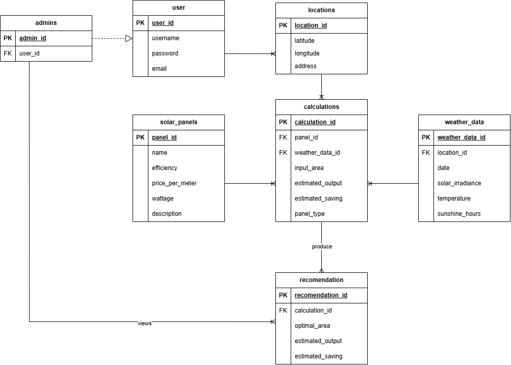

# SolarWise

SolarWise is a climate action web application designed to map and estimate the benefits of solar panel installations. Utilising geospatial weather data, the platform helps homeowners, businesses, and local governments identify high-potential areas for solar energy and calculates the estimated electrical output for specific coordinates.

## TIF Team

Back-End Developer : Muhammad Fachry Alfareeza - 24/540199/TK/59922  
Software Architect : Muhammad Ilkham Abdillah - 24/537977/TK/59653  
Front-End Developer: Monica Anastasya Dantina - 24/544527/TK/60525

# Panduan Pengguna SolarWise

Panduan singkat untuk menggunakan SolarWise dalam mencari potensi energi surya dan memperkirakan hasil pemasangan panel.

## 1. Masuk ke aplikasi

1. Jalankan SolarWise.
2. Masuk dengan email atau username dan kata sandi.
3. Jika belum memiliki akun, pilih **Create a New Account** pada layar login lalu isi formulir pendaftaran.

## 2. Cari wilayah dan data iradiasi

1. Buka menu **Locations**.
2. Masukkan nama kota, kabupaten, atau wilayah Indonesia pada bagian **Find Region and Solar Data**.
3. Tekan **Fetch Climatology**.
4. SolarWise mencari koordinat wilayah, lalu lokasi akan disimpan ke daftar.
5. Pilih lokasi pada daftar untuk melihat nilai iradiasi Januari sampai Desember dan **Day-weighted average**.

## 3. Buat kalkulasi panel surya

1. Buka **Solar PV Calculator**.
2. **Langkah 1 – Lokasi:** isi nama proyek. Pilih lokasi tersimpan jika tersedia atau masukkan koordinat lintang dan bujur.
3. **Langkah 2 – Panel:** pilih jenis panel dari katalog. Daya dan efisiensi panel akan ditampilkan.
4. **Langkah 3 – Luas:** masukkan luas area pemasangan dalam meter persegi. Pratinjau menunjukkan jumlah panel dan kapasitas sistem yang muat.
5. Tekan **Calculate** untuk melihat hasil.

## 4. Simpan dan tinjau hasil

- Pada jendela hasil, pilih **Save Calculation** untuk menyimpan kalkulasi.
- Buka **Calculation History** untuk mencari, membuka, mengganti nama, atau menghapus kalkulasi yang tersimpan.
- Halaman **Home** menampilkan ringkasan kalkulasi

## Cara membaca estimasi

SolarWise memperkirakan produksi tahunan dari kapasitas sistem, iradiasi harian, 365 hari, dan faktor performa 80%. Estimasi penghematan memakai tarif asumsi Rp1.444,70 per kWh. Karena tarif tersebut adalah asumsi, hasil penghematan merupakan perkiraan dan dapat berbeda dari kondisi atau tagihan sebenarnya.

Luas area menentukan jumlah panel yang dapat dipasang. Data iradiasi ditentukan oleh koordinat wilayah, bukan oleh luas area.

### Class Diagram

### Entity Relationship Diagram

